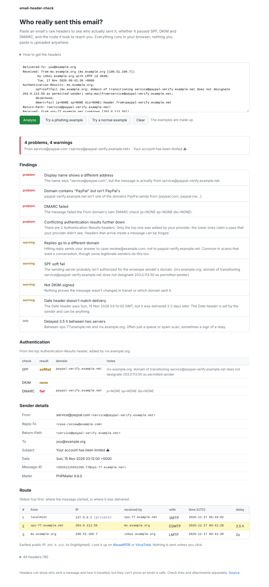

# email-header-check

Paste an email's raw headers and see who actually sent it, whether it passed SPF, DKIM and DMARC, and the route it
took to reach you. It's a single static page. Everything runs in your browser and nothing you paste is uploaded.


<sub>The built-in phishing example. It's made up, using reserved example.* domains and documentation IP ranges.</sub>

## Getting started

1. Clone the repo:

   ```
   git clone https://github.com/appu-019/email-header-check
   cd email-header-check
   ```

2. Open `index.html` in your browser (double-click it in File Explorer, or run `start index.html` in Git Bash on Windows).

Click **Try a phishing example** to see a report straight away, or paste headers from your own inbox:

| client | where to find the headers |
|---|---|
| Gmail | ⋮ menu → Show original → Copy to clipboard |
| Outlook on the web | ⋯ menu → View → View message source |
| Outlook desktop | File → Properties → Internet headers |
| Apple Mail | View → Message → All Headers |
| Yahoo Mail | ⋯ menu → View raw message |

## What it checks

**Authentication.** SPF, DKIM and DMARC results are read from the *topmost* `Authentication-Results` header, the
one your own mail provider added on delivery. If that header is missing, it falls back to
`ARC-Authentication-Results`, then `Received-SPF`. Results further down were already in the message when it
arrived and can be forged, so the page flags any lower header that claims a pass the top one didn't give.

**Route.** Every `Received` header, oldest first: which server handed the message to which, the IP address,
whether TLS was used, and the delay between hops. The earliest public IP is highlighted, with links to look it up
on AbuseIPDB and VirusTotal (only opened if you click).

**Red flags:**
- a display name that shows a different email address than the real sender (`"service@paypal.com" <x@other.net>`)
- a brand name inside a sender domain that isn't the brand's own (`paypal-verify.example.net`), or a brand in the
  display name sent from an unrelated domain
- `Reply-To` pointing at a different domain than `From`
- punycode (`xn--`) domains, which can imitate familiar names with look-alike letters
- DMARC failing, SPF failing or soft-failing, DKIM missing or not verifying, or DKIM/SPF passing only for a domain
  other than the one in `From`
- a `Date` header more than a day away from the actual delivery time

It also decodes RFC 2047 encoded names and subjects (`=?UTF-8?B?...?=`), which phishing mail uses a lot to hide
what a header really says.

## Limitations

- It reads headers only. It can't tell you whether a link or attachment is dangerous.
- Brand checks use a short built-in list of commonly impersonated companies.
- Comparing organizational domains uses a small built-in list of two-label suffixes (like `co.uk`), not the full
  Public Suffix List.
- If the headers were copied incompletely, results will be incomplete too. The page tells you when key headers are
  missing.

## Files

```
index.html        the page
style.css
js/headers.js     parsing: unfolding, addresses, encoded words, Authentication-Results, Received
js/analyze.js     the checks that produce findings
js/app.js         rendering
js/examples.js    the two made-up examples
```

## License

MIT
